# Deckmark

**A Claude Code skill for finance-grade decks and PDF reports that look designed, not generated.**

Strategy decks, CIMs, teasers, pitch books, IC memos, credit memos, LP letters, board packs, investor days and public-sector reports. Nineteen house styles, thirteen storylines, every figure traced to a source.

<p align="center">
  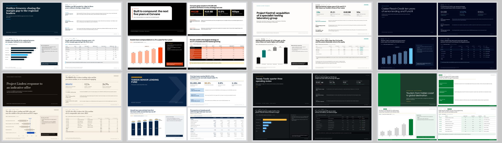
</p>

## New in v0.6

- **Redesign and audit.** `/deckmark redesign <deck.pdf|.pptx|.html>` records every page and every figure of an existing client deck, drafts `facts.json` and a storyboard from it, rebuilds the deck lean and in the client's brand, and fails its own sweep if a figure went missing (`redesign.mjs kept`). `/deckmark audit <deck>` reports words, figures, source lines and title lengths page by page and changes nothing.
- **Hallmark-depth references.** Slide craft, layout and filling, finance chart rules, font pairing and offline stacks, how to pick and justify a house style, a locked `DECK.md` house system, export formats and PPTX limits, patterns for facts, totals and judgment flags, a cover review and a finish review, and a storyline index with a Short form for thin material in every storyline. SKILL.md is leaner (144 lines) and loads each by step. The full map is in [docs/HALLMARK-GAP.md](docs/HALLMARK-GAP.md).
- **Dead bands and dropped labels.** decklint's new `dead-band` reflex catches a KPI or column row floating mid-slide over an empty band, and `.col-row.big` sets short figures as tiles that take the body height. `charts.mjs` no longer drops the value of a short stacked segment: it labels it beside the bar, and widens bars so tall segments carry their labels inside.
- **Brand accents that are only thin rules** (a red rule on a navy and white deck) are found by hue distinctness, not only by area.
- **Install, hook, tests.** `install.mjs` installs for Claude Code, Codex and OpenCode (copy or `--link`); `install-hook.mjs` wires an opt-in edit-time lint that blocks only on a Floor FAIL; `refcheck.mjs` holds the references together; 61 `node --test` unit tests cover theme, deal and reroll exhaustion, every decklint rule, charts, brand, render, redesign, the hook and the installers.

## What it does

Deckmark holds a hard floor and then gets out of the way. It reads your material, picks a storyline for the reader and the decision, deals a house style that fits the audience, builds the deck as HTML, renders it to PDF and PNG, and lints it in a real browser. A fresh-context reviewer and an independent tie-out get the last word.

- **Gates in three tiers.** The **Floor** never ships: invented facts, figures that do not tie, topic-label titles, exhibits with no source line, literal colours, overflow and clipping, text under the minimum size, AI tells, firm names or logos. **Reflex** gates are the defaults a model falls into (a legend on a two-series chart, a wall of bullets, three slides with no exhibit, a half-empty slide, KPI tiles with nothing under them); a deck may waive one on the record with a reason. **Finish** checks are craft and never block.
- **A house style per audience.** `theme.mjs deal` offers three of nineteen themes that fit the reader's field and the brief, rotated against a project log so two decks in a row do not look the same. A theme is a material (palette, type, slide furniture, chart style). It never sets the slide order.
- **A storyline per document.** Thirteen storylines give the slide order, each slide's job and its archetype. `theme.mjs draw` deals the cover posture, exec-summary form, chart emphasis, title form, close and lead exhibit. The spine is written as a ghost deck (one line per slide with its status) before anything is built.
- **Numbers that tie by machine.** Every printed figure lives in `facts.json` with its source and is wrapped in `data-fact` where it prints. decklint compares each one, recomputes derived figures from their `formula`, checks that total rows add up and that sources equal uses.
- **Lean by default.** Every storyline sets a body-word budget per slide, calibrated on real decks (large-manager investor days run 30 to 80 words a slide, bank-made CIMs 150 to 230 carried as charts and short bullets). Pitch, fund and investor decks cap at 80; slide CIMs at 160; memos and A4 reports keep running text. Big-number comparisons, ring pairs, cycles, flows, brackets, proof-number column rows and full-bleed statements come before tables and paragraphs.
- **Client brand.** `brand.mjs` reads the client's own deck (PDF or PNG pages), finds its paper, ink and brand colours by flat area, contrast-checks them, and `scaffold --brand` re-skins the theme in them.
- **Build, render, lint.** HTML slides at 1280x720 or A4 report pages. `charts.mjs` draws 11 chart types (bar, ranked bar, stacked, grouped, waterfall or bridge, line, combo, marimekko, football field, harvey balls, sparkline) and three lean diagrams (ring, cycle, flow) as SVG in the theme's tokens. `render.mjs` writes the PDF and one PNG per page through Playwright Chromium. `decklint.mjs --render` checks the page as Chromium lays it out. A PPTX is built from the PNGs only when asked (the converter is not shipped in this repo yet, see [ROADMAP](ROADMAP.md)).
- **Reviewed cold.** A subagent reads only the PNGs, the storyboard and the reviewer prompt and answers `ship`, `fix` or `rebuild`. A second subagent re-reads the source documents (never `facts.json`) and marks every printed figure MATCH, ROUNDING-OK, DERIVED-OK, MISMATCH or UNSUPPORTED.

Confidential material renders offline: no Google Fonts request, system font fallbacks only.

## Install

As a Claude Code plugin:

```
/plugin marketplace add tabani-png/deckmark
/plugin install deckmark@deckmark
```

A plugin install is invoked as `/deckmark:deckmark`.

Or from a clone, with the installer (it runs refcheck and the theme check first, then installs for every harness it finds: Claude Code, Codex CLI and Cursor, OpenCode):

```
git clone https://github.com/tabani-png/deckmark
node deckmark/skills/deckmark/scripts/install.mjs          # copy into ~/.claude/skills, ~/.agents/skills
node deckmark/skills/deckmark/scripts/install.mjs --link   # or a symlink that tracks the clone
```

Edit-time lint is opt-in: `node skills/deckmark/scripts/install-hook.mjs` (this project) or `--global`. After an agent writes a deck it runs decklint's static tier; a Floor FAIL blocks with the findings, anything else is a note or silence. `--remove` takes it out.

The render and the browser lint need Node 20 and Playwright Chromium. Run this once in the folder that holds `skills/` (your clone, or the plugin's marketplace copy):

```
npm install
npx playwright install chromium
```

Without Playwright the theme tools, the chart CLI and the static lint still run; `render.mjs` and `decklint --render` do not. Redesigning a PDF needs poppler (`brew install poppler`, `apt install poppler-utils`).

## Usage

```
/deckmark <brief>
/deckmark theme <slug> <brief>
/deckmark redesign <deck.pdf|deck.pptx|deck.html>
/deckmark audit <deck.pdf|deck.pptx|deck.html>
```

Deckmark asks once for four things (material, reader, document, style) and infers what you skip. It never infers a fact. Example briefs:

- **Credit memo.** `/deckmark credit memo for a $85M unitranche to a packaging company, for our credit committee. Material: ./dataroom (audited FY22-FY24, FY25 budget, term sheet).`
- **CIM.** `/deckmark sell-side CIM summary for a dental services platform, for PE buyers in round one. Material: ./cim-inputs. Keep it to about 15 slides.`
- **Strategy deck.** `/deckmark strategy deck for a regional bank's CFO and executive committee on an AI roadmap for finance, with the options, the cost bridge and the ask. Material: ./notes.md`

Work happens in your own project folder: `deck/` for `deck.html`, `facts.json` and the renders, `.deckmark/` for the preflight, storyboard, log and lint output. The scripts refuse to write inside the skill folder.

## Themes

<table>
  <tr>
    <td width="20%"><a href="skills/deckmark/references/themes/meridian.md">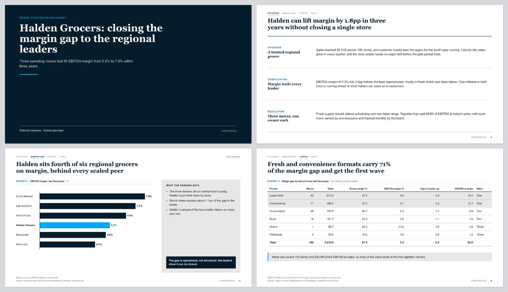</a></td>
    <td width="20%"><a href="skills/deckmark/references/themes/gridline.md">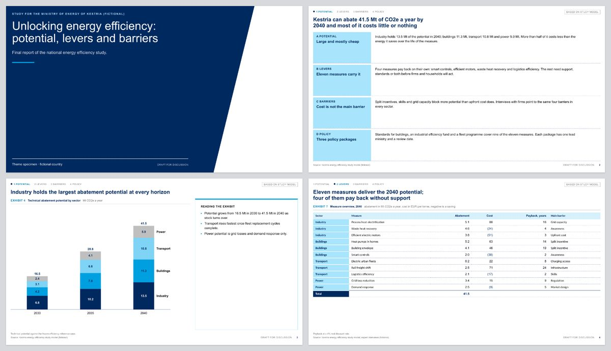</a></td>
    <td width="20%"><a href="skills/deckmark/references/themes/quiet-mandate.md">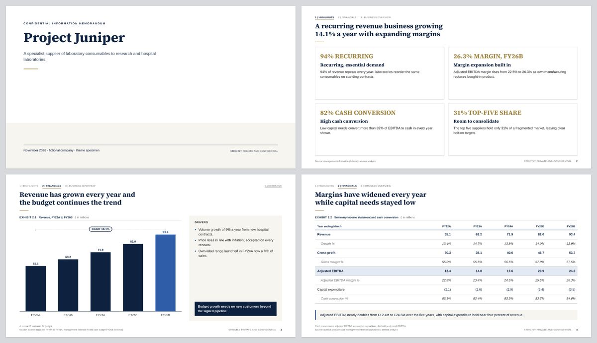</a></td>
    <td width="20%"><a href="skills/deckmark/references/themes/fairness-room.md">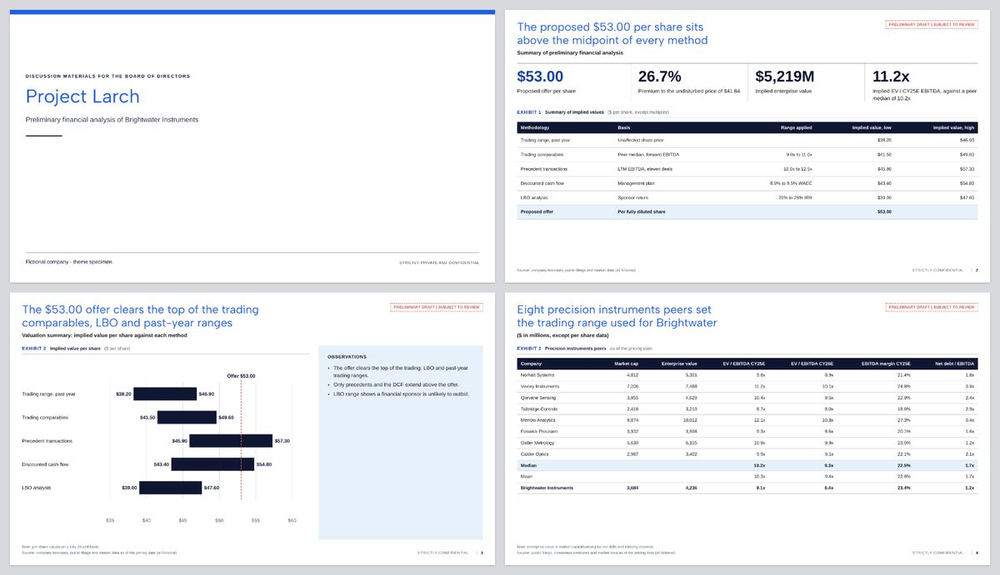</a></td>
    <td width="20%"><a href="skills/deckmark/references/themes/specimen.md">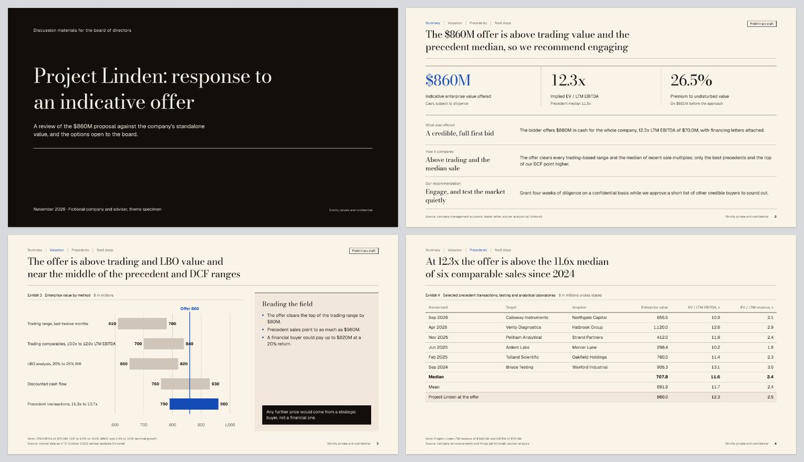</a></td>
  </tr>
  <tr>
    <td valign="top"><b>Meridian</b><br/><sub><code>consulting</code> · SCR strategy decks: serif action titles, navy and one electric blue</sub></td>
    <td valign="top"><b>Gridline</b><br/><sub><code>consulting</code> · dense research reports, as slides or A4</sub></td>
    <td valign="top"><b>Quiet Mandate</b><br/><sub><code>banking</code> · CIMs and sell-side teasers, as slides or A4</sub></td>
    <td valign="top"><b>Fairness Room</b><br/><sub><code>banking</code> · pitch books and dense board discussion materials</sub></td>
    <td valign="top"><b>Specimen</b><br/><sub><code>banking</code> · boutique pitch books and strategic alternatives reviews</sub></td>
  </tr>
  <tr>
    <td width="20%"><a href="skills/deckmark/references/themes/ink.md">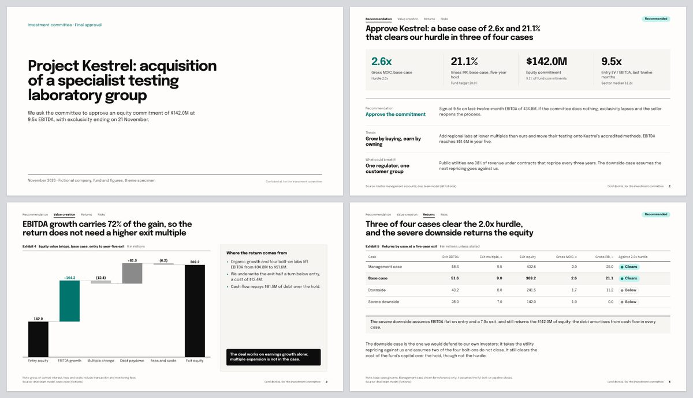</a></td>
    <td width="20%"><a href="skills/deckmark/references/themes/vantage.md">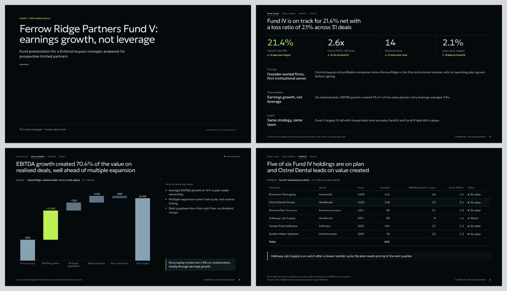</a></td>
    <td width="20%"><a href="skills/deckmark/references/themes/ochre-covenant.md">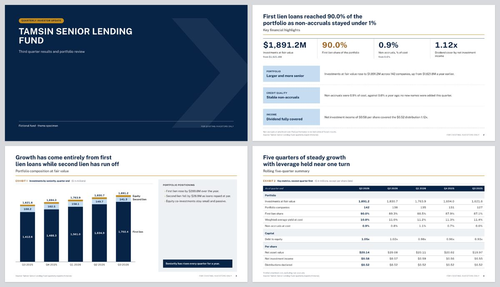</a></td>
    <td width="20%"><a href="skills/deckmark/references/themes/ember-block.md">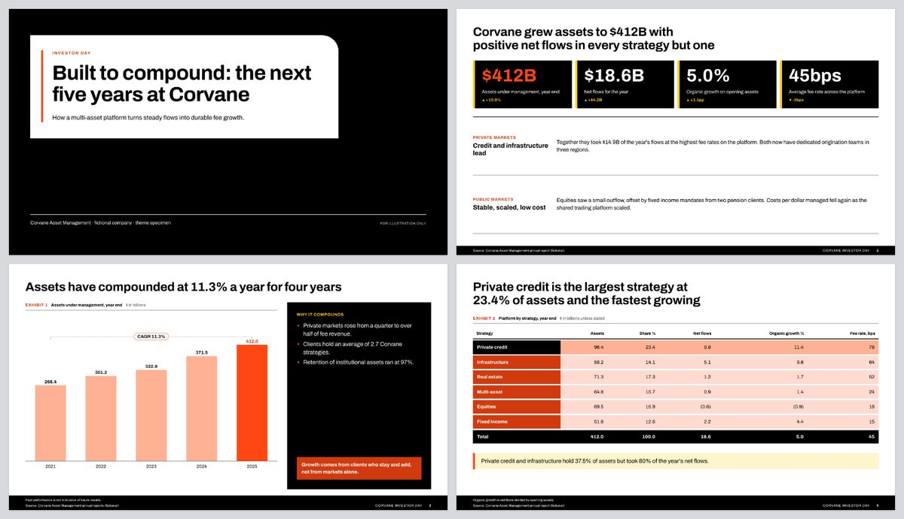</a></td>
    <td width="20%"><a href="skills/deckmark/references/themes/midnight.md">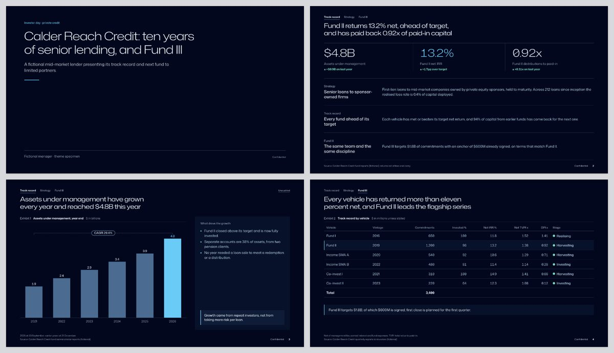</a></td>
  </tr>
  <tr>
    <td valign="top"><b>Ink</b><br/><sub><code>pe</code> · IC memos and LP letters in plain black with one state colour</sub></td>
    <td valign="top"><b>Vantage</b><br/><sub><code>pe</code> · fund-raising decks on a blue-black ground with one lime signal</sub></td>
    <td valign="top"><b>Ochre Covenant</b><br/><sub><code>credit</code> · credit memos and direct lending fund decks with rolling tables</sub></td>
    <td valign="top"><b>Ember Block</b><br/><sub><code>asset-mgmt</code> · investor day and earnings supplements, black and white with one hot colour</sub></td>
    <td valign="top"><b>Midnight</b><br/><sub><code>asset-mgmt</code> · investor day decks shown on a dark stage</sub></td>
  </tr>
  <tr>
    <td width="20%"><a href="skills/deckmark/references/themes/vellum.md">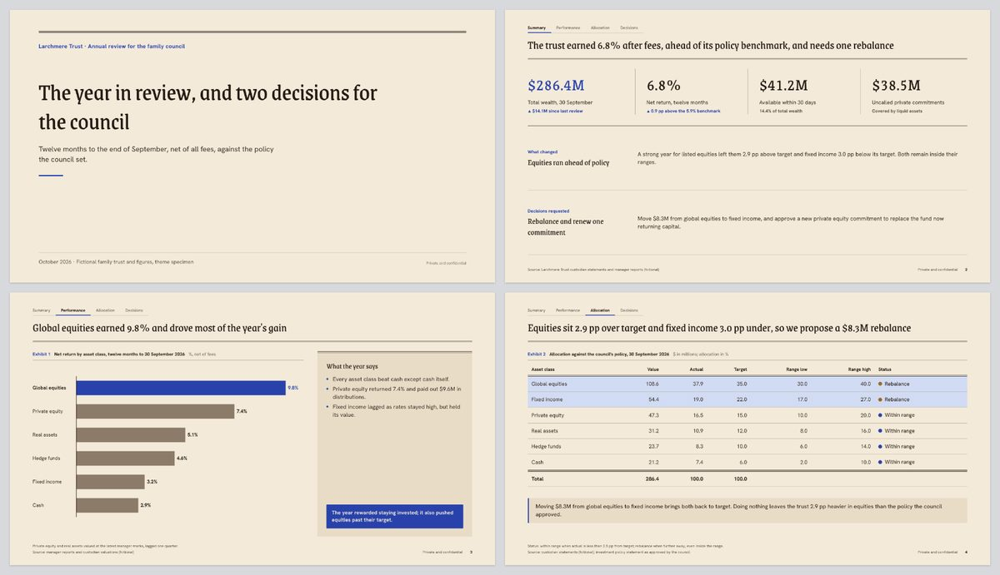</a></td>
    <td width="20%"><a href="skills/deckmark/references/themes/console.md">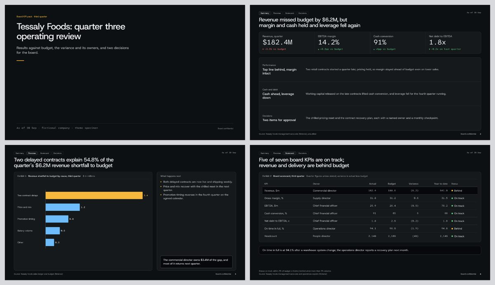</a></td>
    <td width="20%"><a href="skills/deckmark/references/themes/glasswork.md">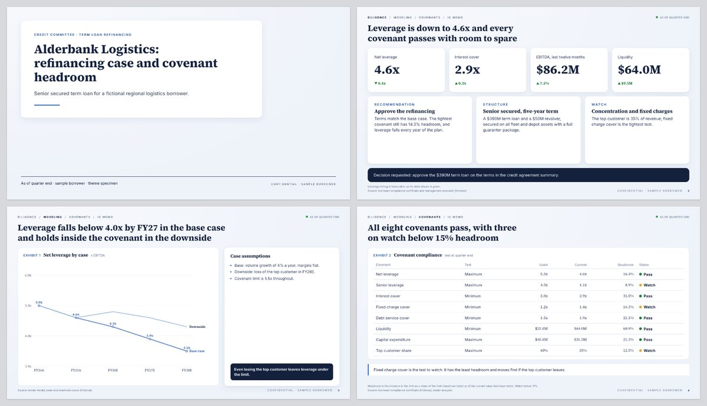</a></td>
    <td width="20%"><a href="skills/deckmark/references/themes/editorial.md">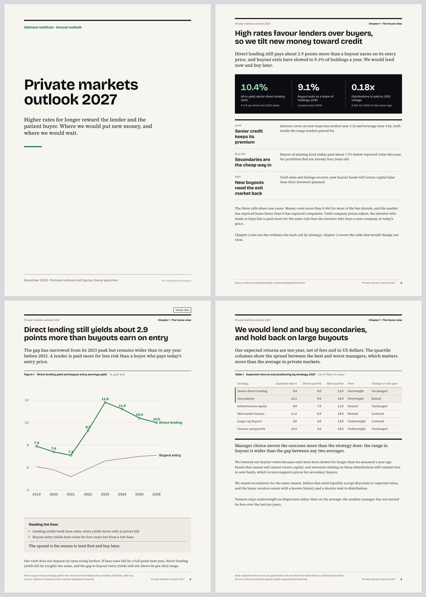</a></td>
    <td width="20%"><a href="skills/deckmark/references/themes/newsprint.md">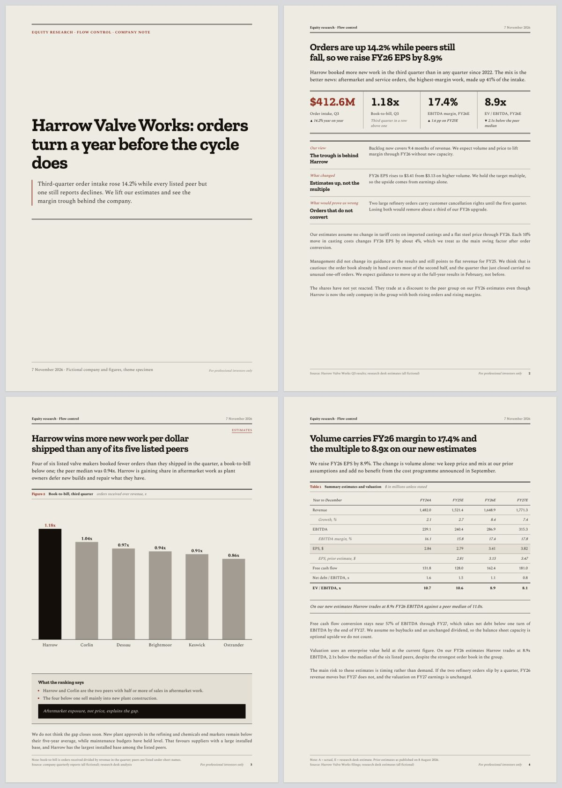</a></td>
  </tr>
  <tr>
    <td valign="top"><b>Vellum</b><br/><sub><code>asset-mgmt</code> · family office and private bank client reviews on cream stock</sub></td>
    <td valign="top"><b>Console</b><br/><sub><code>dashboard</code> · board packs and monthly management packs, graphite with amber</sub></td>
    <td valign="top"><b>Glasswork</b><br/><sub><code>dashboard</code> · monitoring packs and credit memos on frosted cards with KPI deltas</sub></td>
    <td valign="top"><b>Editorial</b><br/><sub><code>editorial</code> · annual outlooks and thought leadership, A4 magazine</sub></td>
    <td valign="top"><b>Newsprint</b><br/><sub><code>editorial</code> · equity research notes and market outlooks, A4 broadsheet</sub></td>
  </tr>
  <tr>
    <td width="20%"><a href="skills/deckmark/references/themes/folio-north.md">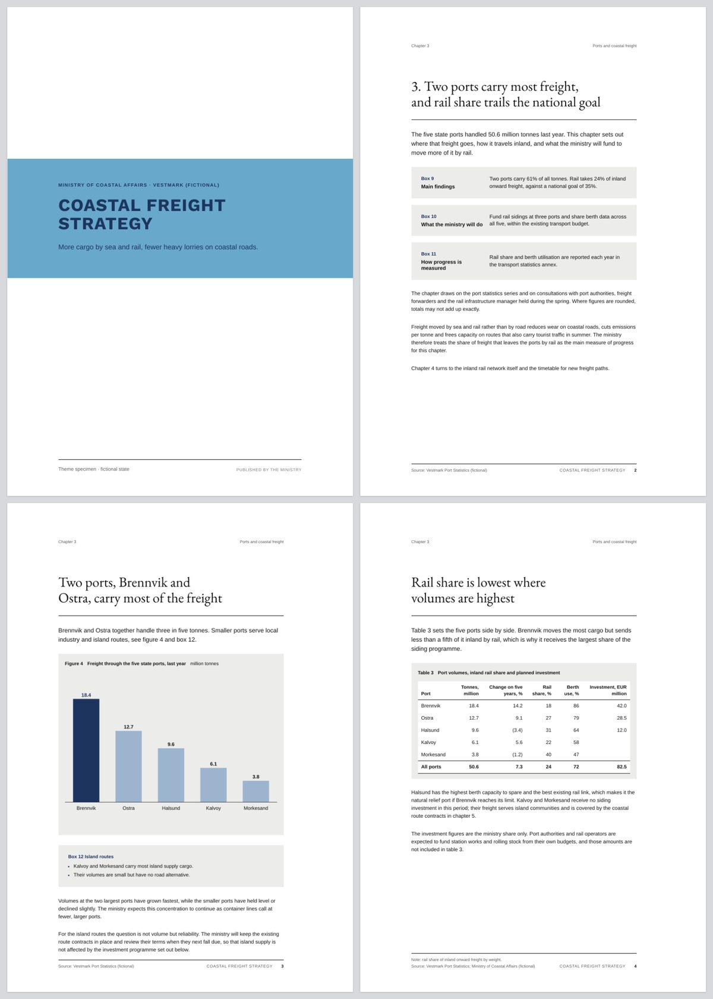</a></td>
    <td width="20%"><a href="skills/deckmark/references/themes/harbourlight.md">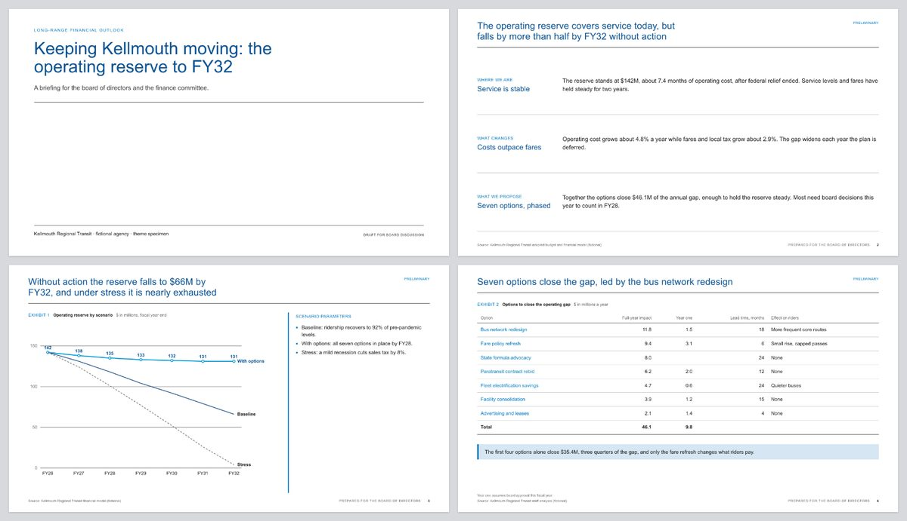</a></td>
    <td width="20%"><a href="skills/deckmark/references/themes/ledgerline.md">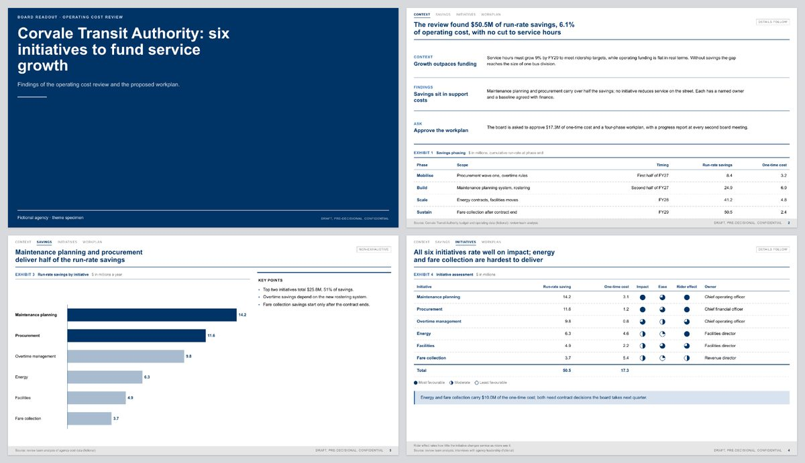</a></td>
    <td width="20%"><a href="skills/deckmark/references/themes/verdance.md">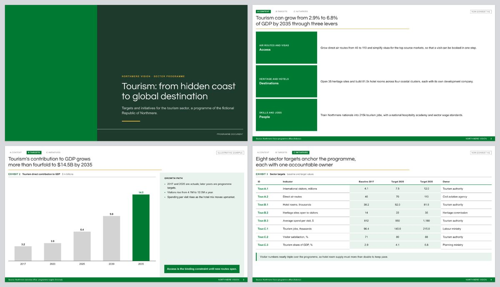</a></td>
  </tr>
  <tr>
    <td valign="top"><b>Folio North</b><br/><sub><code>public-sector</code> · ministry strategy white papers, A4 with chapter numbers</sub></td>
    <td valign="top"><b>Harbourlight</b><br/><sub><code>public-sector</code> · city and economic development agency reports</sub></td>
    <td valign="top"><b>Ledgerline</b><br/><sub><code>public-sector</code> · dense board readouts for public agencies</sub></td>
    <td valign="top"><b>Verdance</b><br/><sub><code>public-sector</code> · national programme and economic vision reports</sub></td>
  </tr>
</table>

Each theme is one file in [`skills/deckmark/references/themes/`](skills/deckmark/references/themes/) with a picture beside it: tokens, type, slide furniture, exhibit rules, dials and a list of the tells that break it. Theme names are original; a theme may be inspired by a kind of document, never by a named firm. `cfo` and `wealth` readers deal through the fields that fit them (cfo: dashboard, consulting; wealth: asset-mgmt, editorial).

## Storylines

One file each in [`skills/deckmark/references/storylines/`](skills/deckmark/references/storylines/), with the reader, the decision it drives, the length, the slide order and a short form for thin material.

| Storyline | Reader and decision |
| --- | --- |
| `scr-strategy` | CEO, CFO or steering committee; adopt the recommendation |
| `cim` | corporate development and PE deal teams; submit an indication of interest |
| `teaser` | screeners at funds and corporates; sign the NDA |
| `pitch-book` | founder, CEO or board; hire the adviser |
| `ic-memo` | PE investment committee; invest |
| `credit-memo` | credit committee; lend |
| `dd-report` | buyer's deal team, IC and lenders; price and protect |
| `fund-pitch` | LP investment staff and consultants; commit |
| `lp-letter` | LPs monitoring the fund; hold and re-up |
| `board-pack` | directors; approve the decision list |
| `investor-day` | sell-side analysts and portfolio managers; own the stock |
| `wealth-review` | family principals and their investment committee; stay the course or rebalance |
| `public-sector-review` | ministers, oversight bodies and audit committees; reform |

## The gates in short

- **Floor (never waivable).** No invented facts. Every figure ties and derived figures recompute. Action titles of 8 to 20 words, two lines max. One message per slide. A source line and a unit on every exhibit; charts drawn from data. Tokens only. Nothing overflows or clips; 16:9 body 14px, tables and labels 10px, furniture 9px (A4: 11px, 8pt, 7pt). Numbers set as numbers. No AI tells, no em dashes. No firm names or logos.
- **Reflex (waivable with a reason).** Nineteen gates, R1 to R19, most checked by decklint: too many hues, chart junk, bullet walls, no exhibit for three slides, repeated archetypes, centred numbers, numbered-box cards, KPI tiles with no comparison, topic-label dividers, chart shadows, stock images, empty slides, gap sprawl, stat-only slides, stretched table rows, slides over their storyline's word budget (`wordy`) and label | paragraph tables in lean decks (`prose-table`), and empty bands between a figure row and the takeaway bar (`dead-band`).
- **Finish (never blocking).** The titles alone tell the story, each chart's one highlight is what the title names, the last slide is the ask, white space is even.

Full rules: [`skills/deckmark/references/gates.md`](skills/deckmark/references/gates.md).

## How it was tested

`npm test` runs `refcheck`, the `node --test` unit suites in `test/unit/` (theme check on LF and CRLF files, deal stability and reroll exhaustion, the draw, scaffold, log rotation, every decklint rule on a tiny fixture, charts, brand, render, redesign, the lint hook and the installers), then `test/run.sh`: theme validation, the deal and the draw, a fictional fixture deck rendered and linted clean with a full tie-out, broken decks that must FAIL on overflow, sources, tie-out, totals, sources and uses and formulas, reflex fixtures, an A4 smoke test, all chart types, the scripts run through a symlinked skill path, and every theme's starter deck linted with `--strict`. CI runs the same on every push, plus the eval harness's offline tests.

Beyond the unit tests, the skill was run end to end twice by agents in [herdr](eval/README.md), each on three fictional cases with a `material.md` brief: a dental services CIM, a packaging company credit memo and a bank's AI-in-finance strategy deck. Each run reported its theme, lint result, the fresh reviewer's verdict, an independent tie-out and every place the skill was unclear.

- **Round 1 (v0.1).** Three decks of 14 to 17 slides, all lint PASS. Tie-outs: 0 mismatches on two decks, one rounding mismatch on the credit memo (a CAGR printed 5.5% that rounds to 5.6%), fixed. The runs found real gaps: scripts went silent through a symlinked skill path, the linter's body minimum disagreed with the gates, sources and uses and derived figures were not checked by machine. Fixed in v0.2.
- **Round 2 (v0.2).** Three decks of 11 to 13 slides, cut to what the material could carry, all lint PASS with `--strict`. Tie-outs: 0 mismatches on all three. The credit memo's first lint caught 27 FAILs (a cover overflow, a contrast failure, figures that did not tie, a covenant cushion off by 0.1) that were fixed at the root. Remaining gaps (seed handling, field names, the `data-fact` example, a split cover with no component, the tie-out's timing) were fixed in v0.3.

Every fresh-context review in both rounds answered `fix`; most findings were fixed before handoff and the rest are listed with reasons. The briefs, decks, facts, PDFs and full reports are in [`eval/herdr/`](eval/herdr/).

## Credits

Deckmark's architecture follows [Hallmark](https://github.com/Nutlope/hallmark) (MIT): Floor, Reflex and Finish gates, a dealt theme rotated against a log, a structural draw, a browser linter and a fresh-context reviewer. Eight themes are adapted from Hallmark themes of the same name: midnight, vantage, console, newsprint, editorial, vellum, ink and specimen. See [`LICENSE`](LICENSE) and [`skills/deckmark/scripts/NOTICE`](skills/deckmark/scripts/NOTICE).

## Licence

MIT.
